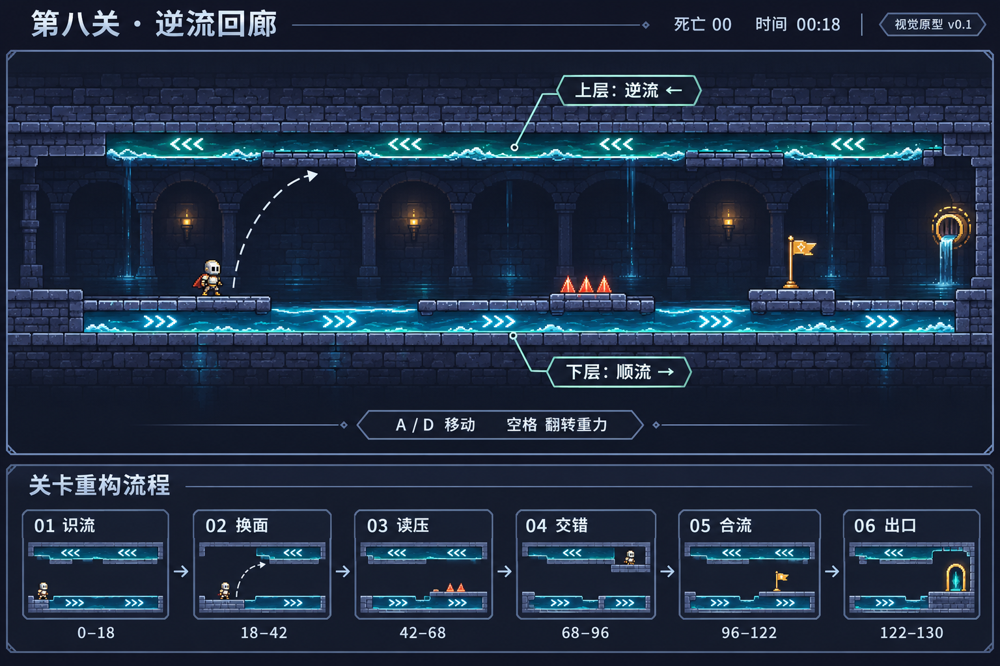

# 第八关 · 逆流回廊

| 版本 | 日期 | 状态 | 范围 |
|---|---|---|---|
| v0.1 | 2026-11-19 | 视觉与关卡提案，未实装 | 第八关水流外观、机关反馈与分段流程 |



本轮按用户要求以原型图和文本展示，采用 game-design-document 的机制、关卡、视觉、实现与验收结构。图为美术方向示意，不是游戏运行截图，也不是精确碰撞地图；最终坐标与机关逻辑以灰盒验证为准。

## 1. 设计基线

已从现有工程确认：Unity 2D、PC 单人、ASCII 地图运行时搭建；第八关为 130×12 格「齿轮带」，含上下反向传送带、横向炮台、尖刺与检查点。角色只有左右移动和翻转重力，没有跳跃。贴面翻转寻找对侧平台，空中翻转只改变重力。

本轮定位为本作已有玩家的终关重构，不新增操作键。目标受众暂按已完成前七关、熟悉翻转节奏的玩家设计。玩法先例采用本作第二关的上下危险面交替、第五关的安全落脚点和第八关现有带速模型，避免引入额外学习负担。

**一句话玩法：沿下层顺流推进，在地刺前翻到上层逆流减速，读取喷口蓄压信号，再翻回安全水道。**

水在普通重力下不会贴住天花板，因此设定为遗迹的「逆重力石渠」：水流贴附石渠内壁，上下都有实体石材支撑。浅水只表现表面流向，不形成游泳区域。

## 2. 视觉与界面

| 原元素 | 新表现 | 玩家应读到的信息 |
|---|---|---|
| 地面右向履带 | 青蓝浅水石渠、右移白色泡沫、重复 `→` | 顺流向右推 |
| 顶部左向履带 | 青绿倒挂水渠、左移泡沫、重复 `←` | 逆流向左推 |
| 金属炮台 | 嵌墙圆形泄压喷口、琥珀色蓄压环 | 即将沿当前高度发射危险脉冲 |
| 子弹 | 橙白色高压脉冲，独立实心轮廓 | 碰到会死亡，与普通蓝水明显区分 |
| 普通检查点 | 干燥石岛、暖金旗帜 | 可以停下来观察和重试 |
| 关卡标题 | 第八关 · 逆流回廊 | 水流与反重力主题 |

浅水视觉深度 0.35–0.45 格，绘制在实体平台表面的浅槽内。可行走边缘保持连续、平直，水面波动不改变碰撞高度；原型中的砖沿起伏只是美术表达，实装时不得造成隐形台阶。箭头与流纹独立绘制，不能因为角色倒挂而反向。

配色：深蓝背景 `#111827`，湿石 `#35435B`，顺流水 `#21B9DF`，逆流水 `#46D6C0`，泡沫 `#D5FAFF`，危险 `#F36C54`，检查点 `#F4C56A`。两种水除了颜色，还靠世界方向箭头区分。

常驻 HUD 沿用关名、死亡数、时间。原型中的外框、六段流程图和水道说明是设计展示层，不作为常驻游戏 HUD。开场环境提示分两条显示：「水会推着你走」「空格翻到另一面」。喷口的预警直接在场景内显示。

## 3. 机制规格

### 3.1 贴面水流

**输入：** A/D 移动，空格/J/Shift 翻转。脚接触水渠实体表面时接受水平推力；离开水渠、进入空中或踏上干石岛后立即停止新增水流影响。翻转仍保留当前水平惯性。

**系统：** 第一版复用 `Conveyor` 的接触带速，不直接复用 `AirCurrent` 的体积加速度；后者会在空中持续推角色，改变已有翻转手感。

```text
vxTarget = clamp(inputX × 8 + currentDirection × 3, -8, +8)
inputX ∈ [-1, 1]；currentDirection：下层 +1、上层 -1；干石岛为 0。
```

因此按 D 时，下层目标速度为 +8，上层为 +5；不按方向键时分别向右/左漂移 3。顺流不会突破当前最大跑速。翻转期间不额外叠加水流，只保留原有翻转惯性。

**反馈：** 角色脚边少量飞溅，白色流纹循环移动；逆重力水渠的方向始终按世界坐标显示。普通水滴无伤害、无触发器。

| 参数 | 默认值 | 调整范围 | 说明 |
|---|---|---|---|
| 水流带速 | 3 格/秒 | 2–3 | 沿用现有第八关数值；[PLAYTEST: 验证逆流可控性] |
| 最大水平速度 | 8 格/秒 | 固定 8 | 本轮不改全局手感 |
| 翻转时长 | 0.08 秒 | 固定 | 沿用 PlayerMotor |
| 对面吸附搜索距离 | 6.5 格 | 固定 | 通道净高维持约 5 格 |
| 表层水动画 | 8 帧/秒 | 6–12 | 画面流动不等于碰撞面移动 |

**依赖与理由：** 依赖现有接地判定、翻转系统与实体平台。以现有齿轮带为机制先例，用水流替换视觉后仍能读出同一套速度关系。

### 3.2 泄压喷口

**输入：** 玩家观察预警，在干石岛等一拍，或翻到对侧躲开。

**系统：** 将随机散布炮台改为两处有明确控制范围的喷口。仅在玩家进入当前机关区、且预警已出现后发射；脉冲只沿一条贴面高度运动，不能同时封住上下两面。离开控制范围后清除脉冲，不能跨检查点追击。

**反馈：** 琥珀色环由空到满，伴随蓄压声；发射时成为橙白实心脉冲。蓝色滴水、背景瀑布和薄雾都不致死，声音尚未实现时也必须能只靠预警环判断。

| 参数 | 默认值 | 调整范围 | 说明 |
|---|---|---|---|
| 发射前预警 | 0.9 秒 | 0.9–1.2 秒 | 预警阶段无伤害 |
| 发射周期 | 3.2 秒 | 3.2–4 秒 | 首发也必须完整预警 |
| 脉冲速度 | 11 格/秒 | 9–11 | [PLAYTEST: 与逆流跑速一起验证] |
| 脉冲尺寸 | 0.5×0.45 格 | 宽 0.4–0.6、高 0.35–0.45 | 判定不得大于可见实心轮廓 |
| 单喷口射程 | 12 格 | 8–12 | 到区块边缘销毁 |

重试时清空脉冲、重置喷口周期；玩家出发并进入控制范围后才开始新的预警。依赖检查点重置与现有子弹生命周期，新增显式预警状态。先例是本关已有横向炮台，重构重点是让死亡原因和可躲避时机可见。

### 3.3 安全换面与检查点

每组地刺/顶刺交界预留不少于 4 格的双面无刺区，换面空间不同时被脉冲覆盖。检查点所在干石岛长度不少于 6 格，水流带速为 0；旗帜接触即激活，出生点附近无致死喷口。干石岛是明确的观察与重试锚点，采用本作第五关安全落脚的设计先例。

## 4. 六段流程与灰盒草案

坐标以世界 x 为准，区间采用左闭右开；下表为提议坐标，尚未写入 `level8.txt`。

| 区间 | 名称 | 内容与玩家动作 | 安全出口 |
|---|---|---|---|
| 0–18 | 识流 | 安全出生；先经过下层水道，看泡沫推动角色，再自行翻上去比较逆流速度；无致死机关 | 入口教学结束后有干燥落点 |
| 18–42 | 换面 | 地刺拟放 x24–25，顶刺拟放 x33–34；地面→顶部→地面的两次换面 | x40 检查点，干石岛覆盖 x37–42 |
| 42–68 | 读压 | x48 喷口向右发射下层脉冲，作用至 x60；对侧水渠保持安全。玩家先看完整预警，再翻上去通过 | x66 检查点，干石岛 x63–68 |
| 68–96 | 交错 | 地刺 x74–75、顶刺 x84–85，两个障碍间均留双面无刺换面区；这一段不放喷口 | x94 检查点，干石岛 x91–96 |
| 96–122 | 合流 | x100 下层喷口作用至 x112，先翻到安全上层；脉冲销毁后的 x112–116 为双面安全区，再在顶刺 x116–117 前翻回下层 | x120 检查点，干石岛 x119–124 |
| 122–130 | 出口 | 水流逐渐退为静水，最后 6 格无致死机关；抵达出口结算 | 终点门拟放 x126 |

```text
出生 → 识别上下流向 → 双次换面 → C40
     → 读预警/避下层脉冲 → C66
     → 地刺/顶刺交替 → C94
     → 避脉冲 → 安全空档换面 → 避顶刺 → C120 → 出口
```

重要约束：96–122 的“合流”指水流、翻转、预警三种已学内容的组合，不是把两面危险在同一 x 位置同时叠加。上层逆流只减速，仍可持续向右走，不要求极短时机连按。

清晰通关目标暂定 35–60 秒；首次探索含重试约 2–4 分钟。这些是调校目标，不是已测试成绩。[PLAYTEST: 以真人首次体验检验停留时间、死亡点和预警可读性。]

## 5. 与当前工程的对应

| 部分 | 后续实现建议 | 原型阶段状态 |
|---|---|---|
| `level8.txt` / hints | 沿用 130×12 外壳，重排水渠、尖刺、喷口、干石岛与四处检查点 | 未修改 |
| `Conveyor.cs` | 第一版复用水平带速与接地触发；不改其他关的运动公式 | 未修改 |
| `ConveyorVisual.cs` | 第八关使用独立 WaterChannelVisual；移除履带滚轮，添加水面、泡沫与方向箭头 | 仅有视觉原型 |
| `LevelBuilder.cs` | 为第八关注入水渠视觉主题，保留 `>` / `<` 的数据含义；避免全局替换其他关卡 | 未修改 |
| `Turret.cs` / `Bullet.cs` | 第八关实例配置蓄压预警、局部射程与重试复位；其他关保持原行为 | 提案，未实现 |
| `GameManager` / `HudGui` | 第八关名改为「逆流回廊」，沿用死亡数与计时 | 未修改 |
| `CameraFollow` | 保留通道中心与完整角色的视野余量 | 无新增镜头机制 |

建议顺序：水渠视觉单房间 → 上下反向带速验证 → 无喷口的六段灰盒 → 加两处预警喷口 → 完整路线验证。最终动效素材应拆为可平铺贴图、泡沫帧、方向标记和喷口状态帧，不把整张概念图直接当游戏背景。

## 6. 验收与待验证项

1. 1280×720 及 4:3、16:9、21:9 视野下，骑士完整可见；上下可接触面和致死轮廓不被水花覆盖。
2. 松开方向键能看出水流漂移；按 D 顺流为目标速度 8、逆流为 5；干石岛不持续推人。
3. 上下箭头与世界流向一致，角色翻面后不反向；没有将“普通蓝水”误认成伤害的情况。
4. 喷口首次发射和复活后首发均完整预警；脉冲不能跨区块、跨检查点残留。
5. 每次必须换面的地方都有明确双面安全空档；组合段绝不出现上下同时无法落脚。
6. 以普通移动与翻转输入完成零死亡路线回归；原型图不替代实际碰撞和节奏测试。

[PLAYTEST: 0.9 秒蓄压是否足够，4 格换面空档在逆流速度下是否自然。]

[OPEN QUESTION: 本提案把炮台同步改成泄压喷口；如果最终只采用水流外观，可保留旧炮台和地图，单独实施视觉版本。]

本次交付为视觉原型 PNG 与此文本提案，未改游戏代码、关卡地图或构建产物。
